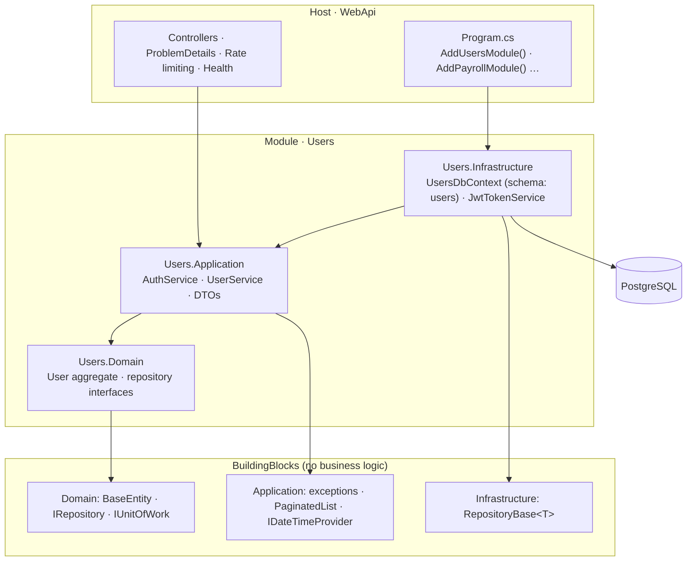

# Modular Monolith .NET Template

[](https://github.com/phinhd/net-modular-template/actions/workflows/ci.yml)


[](LICENSE)

A starter for building a **modular monolith** in ASP.NET Core. Each business module is a self-contained Clean Architecture slice (Domain → Application → Infrastructure) with its own `DbContext` and database schema. A thin Web API host composes the modules with one line each.

The goal is a codebase that starts as a single deployable but keeps module boundaries strict enough that a module can be extracted into a service later without a rewrite.

## What you get

- **Module per bounded context.** `Users` ships as a working example: registration, login, JWT, profile endpoint.
- **Schema per module.** `UsersDbContext` owns the `users` schema and its own migrations history table.
- **Boundaries enforced by tests.** Architecture tests (NetArchTest) fail the build if Domain references Infrastructure, or a module references the host.
- **Consistent errors.** Application exceptions map to RFC 7807 `ProblemDetails` in one `IExceptionHandler`; controllers have no `try/catch`.
- **Fail-fast configuration.** JWT options are validated on startup (`ValidateDataAnnotations` + `ValidateOnStart`), so a missing signing key stops the app instead of breaking the first login.
- **Production basics.** Rate-limited auth endpoints, `/health` with a database check, non-root Docker image, Central Package Management.
- **Real integration tests.** The API runs against PostgreSQL in Testcontainers and applies the real migrations.
- **CI.** GitHub Actions builds with warnings as errors, checks formatting, runs all tests and builds the Docker image.

## Architecture



Dependencies point inward. The host only knows each module's `Add{Module}Module()` entry point and its application services.

## Project structure

```text
src/
  BuildingBlocks/                     Shared kernel — strictly no business logic
    BuildingBlocks.Domain/            BaseEntity, IAggregateRoot, IRepository<T>, IUnitOfWork
    BuildingBlocks.Application/       AppException hierarchy, PaginatedList, IDateTimeProvider
    BuildingBlocks.Infrastructure/    RepositoryBase<T> (EF Core)
  Modules/
    Users/                            Example module — copy this shape for new modules
      Users.Domain/                   User aggregate, IUserRepository, IUsersUnitOfWork, IJwtTokenService
      Users.Application/              AuthService, UserService, DTOs, IEmailSender (+ no-op impl)
      Users.Infrastructure/           UsersDbContext, repositories, JWT, migrations, DependencyInjection.cs
  Host/
    WebApi/                           Composition root, controllers, exception handler
tests/
  Users.UnitTests/                    Application services and domain rules (Moq)
  Architecture.Tests/                 Module boundary rules (NetArchTest)
  WebApi.IntegrationTests/            End-to-end HTTP tests on PostgreSQL (Testcontainers)
```

## Getting started

### Option A — Docker Compose

```bash
docker compose up --build
```

- API: http://localhost:8080 · health: http://localhost:8080/health
- Swagger UI: http://localhost:8080/swagger
- Migrations are applied on startup.

### Option B — run locally

Requires the [.NET 10 SDK](https://dotnet.microsoft.com/download) and a PostgreSQL instance.

```bash
docker compose up -d postgres            # or point ConnectionStrings:UsersDb at your own server
dotnet run --project src/Host/WebApi     # Development profile applies migrations automatically
```

Swagger opens at http://localhost:5080/swagger.

### Try it

```bash
curl -X POST http://localhost:8080/api/auth/register \
  -H "Content-Type: application/json" \
  -d '{"email":"jane@example.com","password":"Password123!","fullName":"Jane Doe"}'

curl -X POST http://localhost:8080/api/auth/login \
  -H "Content-Type: application/json" \
  -d '{"email":"jane@example.com","password":"Password123!"}'

curl http://localhost:8080/api/users/me -H "Authorization: Bearer <token>"
```

## API

| Method | Route | Auth | Description |
| --- | --- | --- | --- |
| `POST` | `/api/auth/register` | — | Create an account, returns a token (201) |
| `POST` | `/api/auth/login` | — | Exchange credentials for a token |
| `GET` | `/api/users/me` | Bearer | Current user's profile |
| `GET` | `/health` | — | Liveness + database check |

Errors use `application/problem+json`:

```json
{ "status": 409, "title": "Conflict", "detail": "Email \"jane@example.com\" is already registered.", "instance": "/api/auth/register" }
```

| Exception | Status |
| --- | --- |
| `BusinessRuleException` | 400 |
| `AuthenticationFailedException` | 401 |
| `ForbiddenException` | 403 |
| `NotFoundException` | 404 |
| `ConflictException` | 409 |
| anything else | 500 (no internal details returned) |

## Configuration

| Key | Default | Notes |
| --- | --- | --- |
| `ConnectionStrings:UsersDb` | local PostgreSQL | One connection string per module; they may point at the same database. |
| `Jwt:SigningKey` | *(empty)* | **Required**, ≥ 32 chars. Set via user-secrets or environment (`Jwt__SigningKey`). Development has a dev-only key. |
| `Jwt:Issuer` / `Jwt:Audience` | `ModularTemplate` / `ModularTemplateClient` | |
| `Jwt:ExpiryMinutes` | `60` | |
| `Database:ApplyMigrationsOnStartup` | `false` (`true` in Development) | Use migration bundles in production pipelines. |
| `RateLimiting:AuthPermitLimit` | `10` | Requests per minute per IP on `/api/auth/*`. |

## Architectural conventions

- **Business-facing interfaces** (e.g. `IUserRepository`, `IJwtTokenService`, whose claims depend on domain concepts like roles) live in `{Module}.Domain/Interfaces` and are implemented in `{Module}.Infrastructure`.
- **Non-business technical interfaces** (email, clock, file storage) live in `{Module}.Application/Interfaces` and can be implemented directly in Application when no heavy SDK is needed.
- **No cross-module database access.** Each module owns its `DbContext` and schema. Other modules go through the owning module's application services or API — never its tables.
- **One DI entry point per module.** `DependencyInjection.cs` exposes `Add{Module}Module(configuration)`; the host never wires a module's internals.
- **Explicit persistence.** Repositories never call `SaveChanges`; application services decide when a unit of work commits.

## Adding a module (e.g. Payroll)

1. Copy `Users.Domain`, `Users.Application`, `Users.Infrastructure` to `Modules/Payroll/Payroll.*` and rename namespaces.
2. **Domain:** entities, `IPayrollRepository`, `IPayrollUnitOfWork : IUnitOfWork`.
3. **Application:** DTOs and services that depend only on the Domain interfaces.
4. **Infrastructure:** `PayrollDbContext` with `HasDefaultSchema("payroll")`, repositories, unit of work and `AddPayrollModule()`.
5. **Host:** call `builder.Services.AddPayrollModule(builder.Configuration)` and add the context to `MigrationExtensions`.
6. Add the projects to `ModularTemplate.slnx` and extend `Architecture.Tests` with the new module's rules.
7. Create the first migration:

```bash
dotnet ef migrations add InitialPayroll \
  -p src/Modules/Payroll/Payroll.Infrastructure -s src/Host/WebApi \
  -c PayrollDbContext -o Persistence/Migrations
```

## Testing

```bash
dotnet test ModularTemplate.slnx          # integration tests need Docker running
```

| Project | Covers |
| --- | --- |
| `Users.UnitTests` | Registration, login, deactivated users, password hashing, email normalisation, domain invariants |
| `Architecture.Tests` | Domain ⟂ Infrastructure/EF Core, Application ⟂ Infrastructure, modules ⟂ host |
| `WebApi.IntegrationTests` | Register → login → `/me`, 400/401/409 problem responses, health check — on real PostgreSQL |

## Design decisions & trade-offs

- **Services over MediatR.** Application services call the unit of work directly, which keeps the template small and easy to read. CQRS/MediatR can be introduced inside a module's Application layer without touching Domain or Infrastructure.
- **Generic repository in BuildingBlocks.** It removes CRUD boilerplate. It returns materialised lists, not `IQueryable`, so query logic cannot leak out of the repositories.
- **Synchronous in-process calls between modules.** Simple and transactional. When modules need to be decoupled further, swap to integration events (outbox + message broker) at the Application boundary.

## Roadmap

- [ ] Refresh tokens with rotation
- [ ] Integration events between modules (outbox pattern)
- [ ] OpenTelemetry tracing and structured logging
- [ ] Real email sender behind `IEmailSender`

## License

[MIT](LICENSE)
